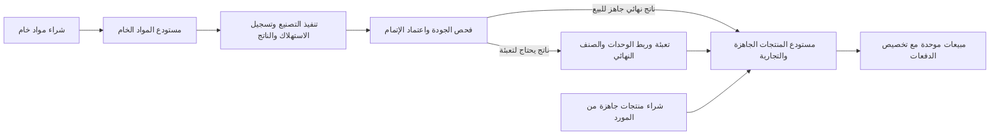

# تحليل إعادة تنظيم المستودعات للنشاط الصناعي والتجاري

**التاريخ:** 13 أكتوبر 2026

**خط الأساس:** الإصدار 1.0.6+7، مخطط المخزون 12، الالتزام `a7a58408636772400fec180cda5c222ae742963a`.

**الحالة:** تحليل وتصميم مقترح قبل التنفيذ. لا يتضمن هذا المستند تغييرًا في كود التطبيق أو مخطط البيانات أو ملفات بيانات المستخدم.

## 1. النتيجة

المطلوب قابل للتنفيذ كتوسعة تدريجية للنظام الموجود. الفصل الأساسي بين المواد الخام ومخزون البيع موجود بالفعل، وتوجد وثائق مشتريات ومبيعات وإنتاج وتحويلات واستعادة بعد الانقطاع. النقص هو مسار شراء البضاعة الجاهزة، واستلام الإنتاج تلقائيًا، وتعريف وحدات التعبئة للصنف، وتوحيد تتبع مصادر الكميات وتكاليفها.

التصميم المناسب: **مستودع مواد خام مستقل + مستودع موحد للمنتجات الجاهزة والتجارية + دفعات مخزون متعددة المصادر داخل الصنف نفسه**. مصدر الكمية صفة للدفعة، وليس تصنيفًا ثابتًا للصنف يمنع شراءه وتصنيعه معًا.

المراجعة مبنية على الكود والاختبارات الموجودة؛ ليست تدقيقًا للأرصدة الفعلية على جهاز المستخدم. خطة حماية البيانات أدناه تحتاج تجربة على نسخة مستقلة من البيانات قبل أي ترحيل فعلي.

## 2. ما يفعله النظام حاليًا

| الجزء | السلوك الفعلي | الفجوة المطلوبة |
|---|---|---|
| المواد الخام | `WarehouseProvider` يحفظ المواد وكمياتها ومشترياتها وحركاتها وأوامر التصنيع والوصفات والدفعات. | توضيح دوره في الواجهة وتعريف وحدات أساسية وتحويلات، وتحسين تتبع تكلفة الاستهلاك. |
| المشتريات | استلام المشتريات يضيف كل سطر إلى المواد الخام ويربطه بالمورد والدفعات المالية ووثيقة الشراء. | إضافة نوع مستقل لمشتريات المنتجات الجاهزة، بوجهة مخزون مختلفة. |
| التصنيع | إنشاء الأمر لا يستهلك المخزون؛ الاعتماد يغير الحالة. الإتمام بعد فحص الجودة يستهلك مقادير الوصفة ويسجل الكمية المخططة كناتج إنتاج. | تسجيل الاستهلاك والناتج الفعليين، وربط الناتج بصنف جاهز وتكلفة مثبتة عند الإتمام. |
| استلام الإنتاج | الناتج يبقى في سجل الإنتاج، ثم يحتاج إلى تحويل يدوي مستقل ليصبح متاحًا في مخزون البيع. | استلام تلقائي قابل للاستعادة ضمن عملية إتمام الإنتاج نفسها عندما يكون الناتج جاهزًا للبيع. |
| مخزون البيع | `ShopProvider` يحفظ المنتجات والمبيعات والجرد. الإضافة اليدوية تزيد رصيد صنف باسم ووحدة وسعر فقط. | الإضافة اليدوية ليست شراءً تجاريًا: لا تسجل موردًا أو فاتورة شراء أو دفعة تكلفة/مصدر. |
| توحيد المنتج | للصنف معرف ثابت، لكن الإضافة والتحويل واختيار الصنف يعتمد كثيرًا على مطابقة الاسم والوحدة. | اختيار الصنف بالمعرف/رمز SKU، لا دمج الأصناف بسبب تشابه الأسماء. |
| مصدر الكميات | البيع يسجل توزيع الكمية على تحويلات الإنتاج. يوجد دعم لانتهاء الصلاحية والإرجاع، لكن البيع من رصيد يدوي/قديم قد يسجل تخصيصًا ناقصًا أو فارغًا. | تعميم التوزيع ليشمل دفعات الموردين والأرصدة الافتتاحية والتسويات. |
| الوحدات | للمخزون وحدة نصية واحدة للصنف، وتغييرها مرفوض عند الإضافة. التحويل في شاشة النقل يعتمد على كميتين يدخلهما المستخدم. | تعريف تحويلات قابلة لإعادة الاستخدام ومراجعتها، خاصة الكرتونة والعبوة. |
| التكلفة | حاسبة الإنتاج والتعبئة تحفظ تقديرات مستقلة. دفعة الإنتاج لا تحفظ تكلفة فعلية مثبتة؛ سعر التحويل المرجعي يصبح السعر المقترح للبيع. | فصل سعر البيع عن تكلفة المخزون، وعدم استخدام آخر سعر أو مسودة تقدير كتاريخ تكلفة فعلية. |
| التخزين | Hive يحفظ حالتين JSON في `warehouse_state_v1` و`shop_state_v1`، والمخطط داخلهما 12. | توسعة مخطط البيانات والتحقق والترحيل؛ لا حاجة لتبديل قاعدة البيانات لهذا النطاق. |

الأجزاء التي يُبنى عليها التطوير: الحسابات المحلية والصلاحيات، العربية والإنجليزية وخط Cairo، وثائق العمليات، المدفوعات والاستردادات، إقفال الفترات، النسخ الاحتياطي، وسجل الاستعادة للكتابة بين المخزنين. تغيير أسماء الصفحات لا يستلزم تغيير أسماء ملفات التخزين.

## 3. سير العمل المقترح

**المسار الصناعي:** شراء مواد خام ← استلام خامات ← أمر ووصفة واعتماد ← تسجيل التنفيذ الفعلي وفحص الجودة ← استلام الناتج الجاهز تلقائيًا ← بيع. اعتماد خطة التصنيع وحده لا ينشئ مخزونًا للبيع. يمكن تسجيل التنفيذ وفحص الجودة والاستلام في خطوة واحدة عندما تنتهي العملية كلها معًا. إذا سُجل التنفيذ الفعلي قبل فحص الجودة، تُخصم المواد عند التنفيذ ويُسجل الناتج «قيد الفحص/غير متاح للبيع»، ثم يحرره الاعتماد دون خصم المواد مرة أخرى. فشل الجودة بعد استهلاك حقيقي لا يعيد المواد إلى الخام تلقائيًا؛ يسجل ناتجًا معزولًا أو هالكًا أو إعادة تشغيل موثقة.

عندما يسجل التنفيذ والإتمام المقبول معًا، يجب تسجيل نقص المواد وحركات الاستهلاك ودفعة الناتج وزيادة الجاهز في **عملية موحدة قابلة للاستعادة**. وفي مسار التنفيذ ثم الجودة المنفصل، تكون كل خطوة ذرية بذاتها؛ خطوة الجودة تحرر الناتج المسجل ولا تعيد إنشاءه. تنفيذ الإتمام ثم النقل كنداءين منفصلين يترك فجوة عند انقطاع البرنامج بينهما. يُوسّع منسق العمليات وسجل الاستعادة الموجود، مع معرف طلب ثابت يمنع التكرار.

إذا كان الناتج سائلًا سائبًا والتعبئة لاحقة، فلا يُحوّل تلقائيًا إلى عدد عبوات مفترض. يسجل كناتج سائب بوحدته وصنفه وحالته، ثم تُسجّل التعبئة الفعلية والفاقد ومواد التغليف والناتج النهائي. إذا كان السائب نفسه يباع، يمكن تعريفه كصنف جاهز مستقل بوحدة لتر أو كغ؛ العبوة النهائية ليست الصنف نفسه لمجرد اشتراك الاسم.

**المسار التجاري:** استلام شراء جاهز من مورد ← وثيقة ودفعة مخزون جاهز مباشرة ← بيع. لا استهلاك خامات ولا أمر تصنيع ولا تحويل إنتاج وهمي. تستخدم العملية قواعد المورد والمدفوعات والاسترداد والصلاحيات الموجودة.

**البيع:** اختيار SKU واحد ووحدة بيع معرّفة ← تحويل إلى الوحدة الأساسية ← توزيع كامل الكمية على الدفعات المؤهلة ← تخفيض الرصيد. يحتفظ كل جزء بمصدره وتكلفته. نحتفظ بسياسة الاستهلاك الحالية FIFO مع استبعاد المنتهي؛ الانتقال إلى سياسة أخرى، مثل FEFO، قرار مستقل.

**الإرجاع:** يحفظ الوثيقة الأصلية، ويعيد الكميات إلى تخصيصاتها الأصلية. إرجاع شراء أو ناتج تصنيع يتطلب توفر كمية الدفعة الأصلية؛ وجود كمية من مصدر آخر لا يعوضها. نستبقي قواعد الاسترداد المالي وإرجاع الوثائق كاملة؛ الإرجاع الجزئي توسعة منفصلة.

## 4. التعديلات المقترحة على البيانات

هذه كيانات ومجموعات داخل التخزين الحالي، وليست اشتراطًا لإنشاء قاعدة SQL جديدة. أسماء الحقول أدناه مقترحة، وتُحسم في مواصفة التنفيذ.

| الكيان | الإضافة/التعديل | الغرض |
|---|---|---|
| المادة الخام | الاحتفاظ بالمعرف، وإضافة رمز صنف ووحدة أساسية وتعريفات التعبئة/التحويل. | مشتريات واستهلاك وجرد بوحدة واضحة، دون دمجها مع مخزون البيع. |
| المنتج الجاهز `Product` | الاحتفاظ بالمعرف، وإضافة SKU ووحدة أساسية وحالة الصنف؛ سعر البيع وعملته منفصلان عن التكلفة. | ظهور المنتج مرة واحدة مهما تعددت مصادره. |
| تعريف الوحدة والتحويل | وحدة ذات رمز ثابت، نوع كمية، سياسة الكسور؛ وتحويل خاص بالصنف بمعرف وإصدار ومعامل معلوم. | منع تحويلات الكراتين والعبوات المفترضة. |
| وثيقة الشراء | نوع `raw` أو `trading` ووجهة مخزون؛ السطر يشير إلى مادة أو منتج جاهز بالمعرف. | فصل الشراءين مع استخدام الموردين والمدفوعات الموجودين. |
| سطر الوثيقة | كمية ووحدة الإدخال + معامل التحويل المثبت + كمية الوحدة الأساسية + مرجع الصنف. | حفظ ما أدخله المستخدم وما دخل المخزون فعليًا دون تغيير التاريخ لاحقًا. |
| دفعة المخزون `StockLot` | الصنف، المستودع، المصدر، وثيقة وسطر المصدر، المورد/دفعة التصنيع، الكمية، الصلاحية، تكلفة وعملة وحالة التكلفة. | دمج المصادر في الرصيد، مع إبقائها منفصلة للتتبع. |
| حركة المخزون | نوع الحركة، المستودع، الصنف، الدفعة، كمية أساسية، مرجع الوثيقة، الوقت، المستخدم ومعرف الطلب. | سجل قابل للمراجعة للاستلام والاستهلاك والإنتاج والبيع والإرجاع والتسوية. |
| أمر/دفعة الإنتاج | صنف الناتج ووحدته، مقادير مخططة وفعلية، مراجع دفعات المواد المستهلكة، الناتج المقبول والفاقد، ولقطة التكلفة. | عدم تغيير الوصفة المعتمدة عند تسجيل اختلاف التنفيذ الفعلي. |
| تخصيص البيع | دفعة عامة + كمية + لقطة/مرجع تكلفة، مع جسر إلى معرفات التحويل القديمة. | بيع الصنف المختلط وتتبع كامل مصدره دون إعادة كتابة المبيعات القديمة. |
| بيانات الترحيل | الإصدار، معرف الترحيل، بصمة الحالة الأصلية، خرائط المعرفات، نتيجة المطابقة. | ترحيل مرة واحدة واستعادة موثوقة بعد الانقطاع. |

**تنظيم المشتريات والموردين:** أوصي بالإبقاء على سجل الموردين ووثائق الشراء ومدفوعاتها في مجموعة التشغيل الحالية، مع تمييز نوع الشراء ووجهته. شراء جاهز يكتب الوثيقة المالية هناك ويضيف دفعة ورصيدًا في مجموعة الجاهز ضمن كتابة منسقة. هذا يتجنب تكرار المورد أو الفاتورة أو الرصيد المستحق في المخزنين. يحتاج `StateSchema` إلى تحقق جديد لمراجع أسطر مشتريات الجاهز بين الحالتين؛ شراء المواد الخام يبقى مرتبطًا بالمواد فقط. الاسم التقني `warehouse_state_v1` لا يعني أن كل وثيقة بداخله تزيد مخزون المواد الخام.

**التحقق الجديد:** مجموع الكميات المتبقية في الدفعات يساوي رصيد الصنف بعد خط بداية الترحيل، وكل حركة جديدة تقابل وثيقة صحيحة، وكل بيع جديد موزع بالكامل على دفعات جاهزة. تبقى السجلات القديمة غير المكتملة محفوظة ومميزة؛ لا نفرض عليها مراجع لم تكن مسجلة أصلًا.

المخطط التالي المقترح يبدأ بإصدار جديد، مثل 13، مع قبول النسخ القديمة 1–12 عبر ترحيل محدد. إذا توزعت الميزات على إصدارات متعددة، يُعطى كل تغيير في شكل البيانات إصدارًا واضحًا. رقم `v1` في اسم صندوق Hive ليس رقم مخطط المخزون.

## 5. الوحدات والتعبئة

تستخدم الأصناف رموزًا موحدة مع أسماء مترجمة: قطعة، حبة، كرتونة، عبوة، كغ، غ، لتر، مل. يمكن ربط «قطعة/حبة» كوحدة عدّ وفق تعريف الصنف، مع إبقاء تسميات الوثائق القديمة كما كانت. لا يعاد تفسير وحدة قديمة مخصصة أو «غالون» دون تحديد معناها.

- 1 كغ = 1000 غ، و1 لتر = 1000 مل: تحويلات داخل البعد نفسه.
- الكرتونة ليست تحويلًا عامًا: صنف A قد يحتوي 12 عبوة وصنف B يحتوي 24.
- العبوة ذات سعة لتر: عدد العبوات ومحتوى السائل معلومتان مختلفتان. يمكن تعريف علاقة خاصة بالصنف، مع منع بيع كسور عبوة مغلقة إذا كان الصنف لا يسمح بذلك.
- كغ ↔ لتر يتطلب كثافة معلومة ومثبتة للمنتج/العملية؛ لا نفترض أن اللتر يساوي كغ.
- التعبئة الفعلية ليست دائمًا تحويل وحدة فقط؛ إذا استهلكت سائلًا وعبوات وملصقات أو أنتجت فاقدًا فهي عملية إنتاج/تعبئة موثقة.
- يُعرض التحويل قبل التسجيل، مع حفظ معامله وإصداره داخل الوثيقة. تغيير حجم الكرتونة لاحقًا لا يغير شراءً أو بيعًا سابقًا.
- نحافظ على دقة كميات الوثائق الحالية حتى ست منازل، ونستخدم حساب تحويل محدد الدقة مع رفض النتائج غير القابلة للتمثيل حسب سياسة الوحدة، بدل تقريب كمية غير واضحة بصمت.

## 6. فصل التكلفة عن سعر البيع

دفعة المورد تحتفظ بتكلفة الشراء وعملتها، لا بسعر البيع. دفعة الإنتاج تحتفظ بتكلفة المواد المستهلكة ومصادر تسعيرها والمكونات الإضافية المعتمدة والتكلفة الإجمالية والناتج الفعلي. يُوسّع تتبع دفعات المواد الخام عند الحاجة لاشتقاق تكلفة استهلاك حقيقية؛ استخدام آخر سعر للمادة لا يثبت تكلفة تاريخية.

التكلفة تكون `unknown` أو `estimated` أو `confirmed` بحسب بياناتها. القيمة المجهولة ليست صفرًا، وتقديرات حاسبة الإنتاج الموجودة لا تصبح تكلفة فعلية تلقائيًا. الأسعار المرجعية في التحويلات القديمة لا تُرحّل كتكلفة تصنيع.

لا نجمع تكلفة USD وSYP دون عملة تكلفة معتمدة وسعر تحويل مثبت ومرجعه. تسجيل تكلفة الدفعة يختلف عن ترحيل تقييم مخزون محاسبي وCOGS. القيود الحالية تسجل المشتريات في حساب 5000 والمبيعات كإيراد؛ لا تتضمن تقييمًا آليًا للخام/الجاهز أو تكلفة بضاعة مباعة. لذلك نحافظ على القيود السابقة، ونفصل تفعيل المحاسبة المستمرة للتكلفة في مرحلة تعتمد سياسة التقييم والأرصدة الافتتاحية. لا نضيف قيود مخزون فوق قيود المشتريات الحالية فتتكرر المصروفات.

## 7. التعديلات على الواجهات

| الشاشة | التعديل المقترح |
|---|---|
| القائمة/لوحة العمل | «مستودع المواد الخام»، «الإنتاج والتعبئة»، «مستودع المنتجات الجاهزة والتجارية»، وزران واضحان لشراء الخام وشراء الجاهز. |
| الخام | مواد ووحدات وأرصدة وحركات شراء/استهلاك/جرد. سجلات الإنتاج تبقى قابلة للوصول في قسم الإنتاج والتاريخ. |
| الشراء | إعادة استخدام النموذج الحالي بثلاثة أوضاع واضحة: شراء خام، شراء جاهز، بيع. تثبيت الوجهة بحسب الإجراء، واختيار المعرف والوحدة والتحويل والمورد. |
| الجاهز | صف واحد لكل SKU، رصيد إجمالي ومتاح وحالات جودة إن وجدت، ثم تفصيل الدفعات: مصنع/مشتَرى/افتتاحي مجهول. |
| تفاصيل الصنف | الوحدة الأساسية، تحويلات العبوة والكرتونة، الدفعات المتبقية، مصادر الكميات، تكلفة مؤكدة/تقديرية/مجهولة، وسعر البيع منفصل. |
| الإنتاج | صنف الناتج، خطة مقابل تنفيذ فعلي، فحص الجودة، بيانات التكلفة، ومعاينة الاستلام التلقائي. توجيه أزرار التصنيع المباشر القديمة إلى الخدمة الموحدة، مع إبقاء تاريخها وأدوات التصحيح. |
| التحويل/التعبئة | اختيار أصناف ووحدات معرفة بدل النص الحر، ومعاينة الناتج والفاقد. حفظ سجلات التحويلات القديمة وإرجاعاتها. |
| المبيعات | نفس سير العملاء والمدفوعات، مع اختيار وحدة بيع معرفة وتوزيع الدفعات تلقائيًا. لا يحتاج البائع إلى اختيار «مصنع» أو «تجاري» كصنفين منفصلين. |
| الوثائق والتقارير | فلاتر الخام/التجاري/المصدر/المستودع، سجل حركة للصنف، وروابط من دفعة البيع إلى شراء المورد أو أمر التصنيع. |

«إضافة رصيد» تبقى حالة افتتاح/تسوية بصلاحية وسبب، ولا تعرض كبديل عادي لفاتورة شراء. كما تُصحح تسمية «القيمة الإجمالية» في شاشة المتجر الحالية إن كانت كمية × سعر بيع مرجعي؛ هذه ليست قيمة المخزون بالتكلفة.

يُحافظ على القالب وخط Cairo والألوان والعربية/الإنجليزية. تكييف هذه الشاشات يستفيد من دعم Windows وAndroid/ChromeOS الحالي؛ لا يتطلب واجهات أو قواعد بيانات منفصلة لكل جهاز.

## 8. حماية البيانات والترحيل

1. إكمال أي استعادة/كتابة معلقة ومنع التسجيل أثناء الترحيل؛ حفظ نسخة أصلية كاملة والتحقق منها قبل أي تغيير.
2. قراءة الحالات القديمة وبناء حالات جديدة في الذاكرة، ثم إصدار تقرير مقارنة بالأرصدة والمعرفات والوثائق والمدفوعات والقيود. لا نعيد تشغيل المشتريات أو المبيعات التاريخية لإنشاء المخطط الجديد.
3. حفظ المعرفات وأرقام الوثائق وأسماءها المثبتة ومراجع الإرجاع والتحويل والمستخدمين والفترات والقيود. لا دمج تلقائي للأصناف بالأسماء.
4. تحويل الكميات المتبقية المثبتة من تحويلات الإنتاج إلى دفعات ذات مصدر معروف، مع إبقاء الروابط التاريخية. فرق الرصيد غير المعروف يصبح رصيدًا افتتاحيًا بمصدر/تكلفة مجهولين.
5. إذا تجاوز مجموع الدفعات المثبتة الرصيد الحالي، يتوقف اعتماد ترحيل ذلك الرصيد ويظهر اختلاف للمراجعة؛ لا نحذف دفعات أو نخترع تخصيص مبيعات لتغطية الفرق. تظل النسخة الأصلية صالحة للعمل إلى أن تُراجع المشكلة.
6. المواد الخام القديمة تبقى بكمياتها الحالية. تكلفة ومصدر المتبقي لا يستنتجان من فواتير قديمة إلا إذا تصالح تاريخ الاستهلاك بالكامل؛ خلاف ذلك يُستخدم افتتاح مجهول مع حفظ التاريخ القديم.
7. لا تنسخ كل دفعات الإنتاج القديمة إلى الجاهز. بعض الناتج نُقل وبِيع بالفعل؛ فقط الرصيد غير المحول يحتاج ربط SKU ووحدة ومراجعة قبل الاستلام. الترحيل نفسه لا يزيد المخزون.
8. لا تغيير مستقل لكل Provider: تهيئة التطبيق الحالية تعيد كتابة الحالات بعد القراءة؛ يُضاف مسار ترحيل مشترك قبل هذه الكتابات، بسجل دائم ومعرف وبصمات واستعادة قابلة للتكرار.
9. تحديث النسخ الاحتياطية والتحقق لبيانات الوحدات والدفعات والحركات والتكلفة، مع دعم استيراد النسخ القديمة عبر المسار نفسه. مراجعة حد حجم النسخة الحالي 20 MB عند توسع سجل الحركات.
10. الإبقاء على قبل/بعد وتقارير المطابقة. الرجوع إلى إصدار قديم يتطلب التطبيق والبيانات القديمة معًا؛ لا تشغيل النسخة القديمة على مخطط أحدث أو حذف الصناديق القديمة ضمن الترحيل.

## 9. مراحل التنفيذ المقترحة بعد اعتماد التصميم

| المرحلة | النطاق | شرط قبول المرحلة |
|---|---|---|
| 1. الأساس والترحيل | الأصناف بالمعرفات والوحدات والدفعات العامة، جسر تخصيص التحويلات القديمة والتغطية الكاملة للمبيعات الجديدة، توثيق الإضافات/التسويات، تحقق المخطط وترحيل تجريبي وتقارير المطابقة. | الأرصدة والوثائق الحالية محفوظة، والبيانات غير المعروفة موسومة، والاستعادة لا تكرر الترحيل، وكل بيع جديد مغطى بدفعات دون فقد تتبع المصدر. |
| 2. المشتريات التجارية | نوع الشراء ووجهته، استلام جاهز مباشر، مورد/دفعات مالية/دفعة تكلفة، وواجهة منفصلة، واختبار البيع من هذه الدفعات. | شراء الجاهز لا يغير الخام، ويظهر في البيع والموردين والنسخ الاحتياطية مرة واحدة؛ البيع المختلط يحفظ مورد ومصدر وتكلفة كل تخصيص منذ هذه المرحلة. |
| 3. الإنتاج والاستلام | ربط ناتج SKU، التنفيذ الفعلي والجودة والتكلفة، استلام ذري تلقائي، والتعبئة اللازمة للسائب. | الخام والناتج وحركاتهما تتطابق؛ الفشل وإعادة المحاولة لا يتركان نصف عملية أو رصيدًا مكررًا. |
| 4. واجهات التتبع والإرجاع | توسعة عرض الدفعات والوحدات والإرجاعات والجرد وتقارير حركة الصنف؛ الأساس الآلي لتخصيص البيع موجود منذ المرحلتين 1 و2. | الإرجاع يعيد نفس الدفعات، والجرد يتصالح معها، وتظهر مصادر وتكاليف التخصيص في التفاصيل والتقارير. |
| 5. الإصدارات والقبول | اختبارات قديمة وجديدة، الترحيل على نسخة بيانات، وواجهات Windows/Android/ChromeOS وPDF. | دورة صناعية وتجارية مشتركة تنجح، مع مطابقة الأرصدة والوثائق والمدفوعات وإثبات الاستعادة. |

يُحفظ كل جزء مكتمل في التزام مستقل، وفق طلب حفظ مراحل التطوير السابق. التحليل الحالي لا ينشئ إصدارًا تنفيذيًا جديدًا. سياسة تقييم المخزون وCOGS المحاسبية تُعتمد منفصلة قبل تفعيل قيودها.

## 10. مثال قبول ملموس

الصنف النهائي X هو عبوة محددة متطابقة المواصفات، وحدته الأساسية «عبوة»، والكرتونة 12 عبوة:

- إنتاج داخلي مكتمل: 24 عبوة، تكلفة مؤكدة USD 2 لكل عبوة، دفعة تصنيع مستقلة.
- شراء تجاري: 3 كراتين = 36 عبوة، تكلفة USD 3 لكل عبوة، مورد وفاتورة ودفعة مستقلة.
- الرصيد: **60 عبوة في صنف واحد**؛ مصدر 24 تصنيع و36 شراء. الشراء التجاري لا يغير المواد الخام.
- بيع 30 عبوة، والتصنيع هو الاستلام الأقدم: تخصيص 24 من التصنيع و6 من المورد؛ تكلفة مخصصة USD 66، والمتبقي 30 من المورد. سعر البيع مستقل. هذا اختبار تكلفة تخصيص، وليس ادعاء بأن تقرير الربح/COGS الحالي يرحلها محاسبيًا.
- إعادة المحاولة لا تكرر الاستلام أو البيع. إرجاع البيع كاملًا يعيد الكميات لتخصيصاتها الأصلية وفق ضوابط الاسترداد الموجودة.

اختبارات إضافية لازمة: شراء 500 غ إلى صنف أساسه كغ فيزيد 0.5؛ كرتونة 12 مقابل صنف آخر 24؛ رفض تحويل غير معرف أو كغ/لتر بلا كثافة؛ بقاء الوثائق السابقة ثابتة بعد تعديل تعريف التعبئة؛ فشل الجودة/نفاد الخام/انقطاع الحفظ؛ عدم بيع دفعة منتهية أو محجوزة؛ إرجاع دفعة المورد الأصلية فقط؛ ترحيل رصيد مجهول دون تكلفة مصطنعة؛ استعادة النسخ القديمة والجديدة؛ الصلاحيات وإقفال الفترات وتنسيق العربية على المقاسات المختلفة.

خط الأساس الحالي يضم 72 اختبارًا آليًا ناجحًا في سجل إصدار 1.0.6. هذه تغطي الوظائف الموجودة، ولا تثبت الميزات المقترحة. لم يُعد تشغيلها في مهمة التحليل، لعدم تغيير كود التطبيق.

## 11. قرارات يجب تثبيتها قبل التنفيذ

- هل الناتج النهائي في كل وصفة عبوات جاهزة، أم سائب يحتاج تعبئة، أم كلاهما؟ التصميم يدعم الاثنين ويمنع التخمين.
- تعريف الصنف «نفس المنتج»: المواصفات والسعة والوحدة والتعبئة متطابقة، وليس الاسم وحده.
- الوحدة الأساسية والتعبئات المسموح بها وسياسة الكسور لكل صنف.
- مصادر تكلفة المواد والعمل والمصاريف، وعملة التكلفة وسعر التحويل، وما يُقبل كتقدير مقابل تكلفة مؤكدة.
- سياسة تقييم المخزون المحاسبية وتاريخ بدايتها وأرصدة البداية إن أُريد تفعيل COGS؛ لا يؤخر ذلك فصل مساري الشراء أو تتبع الكمية.

## 12. مواضع الأدلة في الكود

| الدليل | الملف |
|---|---|
| استلام المشتريات الحالي يدخل المواد الخام | [WarehouseProvider:918](C:/Users/baslt/active/lib/providers/warehouse_provider.dart:918) |
| الاعتماد ثم الإتمام بعد الجودة | [WarehouseProvider:110](C:/Users/baslt/active/lib/providers/warehouse_provider.dart:110)، [releaseOrder:124](C:/Users/baslt/active/lib/providers/warehouse_provider.dart:124) |
| استهلاك المواد وتكوين دفعة الإنتاج | [WarehouseProvider:763](C:/Users/baslt/active/lib/providers/warehouse_provider.dart:763) |
| شكل دفعة الإنتاج بلا لقطة تكلفة أو SKU ناتج | [ManufacturedProduct:28](C:/Users/baslt/active/lib/models/manufactured_product.dart:28) |
| التحويل والدمج حسب الاسم والسعر المرجعي | [TransferService:103](C:/Users/baslt/active/lib/services/transfer_service.dart:103) |
| الكتابة المشتركة وسجل الاستعادة | [TransferService:217](C:/Users/baslt/active/lib/services/transfer_service.dart:217)، [main:43](C:/Users/baslt/active/lib/main.dart:43) |
| رصيد متجر بلا فاتورة مورد | [ShopProvider:460](C:/Users/baslt/active/lib/providers/shop_provider.dart:460) |
| توزيع البيع على تحويلات الإنتاج | [ShopProvider:42](C:/Users/baslt/active/lib/providers/shop_provider.dart:42)، [sellProducts:510](C:/Users/baslt/active/lib/providers/shop_provider.dart:510) |
| السماح الحالي بتخصيص جزئي للقديم والرصيد اليدوي | [StateSchema:437](C:/Users/baslt/active/lib/services/state_schema.dart:437) |
| تحقق زوج المخازن | [StateSchema:731](C:/Users/baslt/active/lib/services/state_schema.dart:731) |
| وحدات التعبئة في حاسبة التكلفة فقط | [FillCosting:1](C:/Users/baslt/active/lib/services/fill_costing.dart:1) |
| قيود المشتريات والمبيعات الحالية | [JournalEntry:66](C:/Users/baslt/active/lib/models/journal_entry.dart:66) |
| النسخ الاحتياطي وحدود حجمها والتحقق | [BackupService:8](C:/Users/baslt/active/lib/services/backup_service.dart:8) |
| اختيار الشراء الحالي | [TradeEntryScreen:95](C:/Users/baslt/active/lib/screens/trade_entry_screen.dart:95) |
| إضافة المتجر اليدوية | [ShopScreen:137](C:/Users/baslt/active/lib/screens/shop_screen.dart:137) |
| دورة التصنيع والبيع وإرجاعها القائمة | [business_cycle_test:85](C:/Users/baslt/active/test/business_cycle_test.dart:85) |
| قائمة نتائج الاختبارات الحالية | [automated_inventory.json](C:/Users/baslt/active/qa/automated_inventory.json) |
